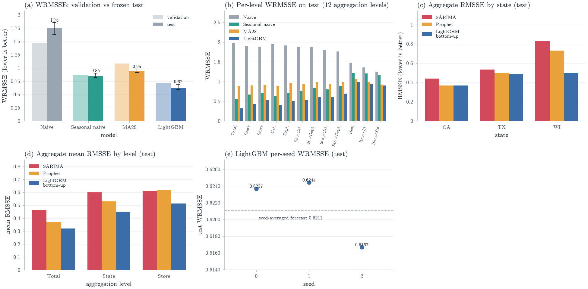

# DS Demand Forecasting

Can a modern forecaster beat the M5 competition's own baselines on the
hidden test week? This project reruns the Kaggle M5 benchmark end to
end: official WRMSSE scoring, a frozen train/validation/test protocol,
verification gates that reproduce the organizers' own numbers, and a
CPU Kaggle kernel. The headline: a seeded LightGBM ensemble reaches
0.6211 test WRMSSE against 0.8470 for seasonal naive.



The figure follows the run: (a) validation versus frozen test WRMSSE
per model, (b) the per-level breakdown across all 12 aggregation
levels, (c) aggregate RMSSE by state, (d) aggregate mean RMSSE by
level, and (e) the three single-seed forecasts and their average.

## Results

| Model | WRMSSE | 95% CI | MAE | Bias |
| :--- | ---: | :--- | ---: | ---: |
| Naive | 1.7520 | [1.6267, 1.8540] | 1.47 | +0.34 |
| Seasonal naive | 0.8470 | [0.8225, 0.9035] | 1.32 | -0.02 |
| MA28 | 0.9462 | [0.9147, 0.9795] | 1.12 | 0.00 |
| LightGBM | **0.6211** | [0.5958, 0.6944] | 1.10 | +0.04 |

- **LightGBM wins on every aggregation level.** Test WRMSSE 0.6211
  [0.5958, 0.6944] versus seasonal naive 0.8470; the paired
  item-cluster bootstrap difference is -0.2259 [-0.2848, -0.1630] and
  all 500 replicates favor LightGBM.
- **The gain is broad, not a fluke of one level.** LightGBM is lowest
  at all 12 levels, from Total 0.320 to Item 0.992 (seasonal naive
  0.560 to 1.223), and bottom-up aggregate RMSSE is lowest at all
  three levels (Total 0.320, State 0.450, Store 0.515); within states,
  Prophet edges it only in CA (0.367 vs 0.369).
- **Against published scores it lands mid-pack.** 0.6211 sits between
  the organizers' published 50th-place 0.5760 and ES_bu 0.6710; the run
  is post-hoc with hindsight, not a leaderboard submission.
- **Three seeds, averaged before scoring.** Single-seed forecasts score
  0.6237, 0.6244 and 0.6167; the seed-averaged forecast enters the
  table (selected config 63x0.03, iteration 444, all configs below the
  round cap).
- **The verification gates all passed.** Our weights reproduce both
  official weight files, the panel equals `sales_test_validation.csv`
  exactly, and our Naive/sNaive WRMSSE reproduces the published table
  on every level (max abs diff 4.2e-15).

## How it works

```text
load 3 competition CSVs + verify 5 official files (sha256)
-> weights + consistency gates -> baselines at val/test origins
-> LightGBM grid on train origins, early stop, val WRMSSE selects
-> persist analysis_plan.json -> read private-window truth once
-> official Naive/sNaive score gate -> refit train+val, seeds 0/1/2
-> official WRMSSE + item-cluster bootstrap -> SARIMA/Prophet -> inventory
```

Validation picks the LightGBM config; `analysis_plan.json` is written
before the private test truth is read (`ordering_ok` in the manifest).

## Run it

```bash
uv sync
uv run pytest
uv run ruff check .
uv run mypy src

# full benchmark (CPU Kaggle kernel; --smoke first for a diagnostic)
scripts/kaggle_run.sh --smoke
scripts/kaggle_run.sh
```

## Notes

- Disclosure: v2.1 reran the model after v2's test numbers had been
  seen; the justification was a validation-only diagnostic (training
  hit the round cap before early stopping could fire), not the test
  outcome. v2 scored 0.6188 vs v2.1's 0.6211, inside overlapping CIs.
- The inventory scenario is an illustration under declared costs
  (critical fractile 0.8, underage = price, overage = 0.25 x price),
  not a measured saving.
- Bootstrap intervals are population-sensitivity bands, not temporal
  uncertainty: replicates sit right-skewed above the point estimate
  (mean 0.6368 vs 0.6211) because item clusters move together.
- Data: Kaggle `m5-forecasting-accuracy` plus the private sha256-pinned
  `m5-official-evaluation` dataset; nothing is committed.
- Protocol `m5-benchmark-v2`, seed 42, LightGBM seeds {0,1,2}, 500
  bootstrap replicates seed 0. Curated output is in `results/` and
  `image.png` renders from it.
